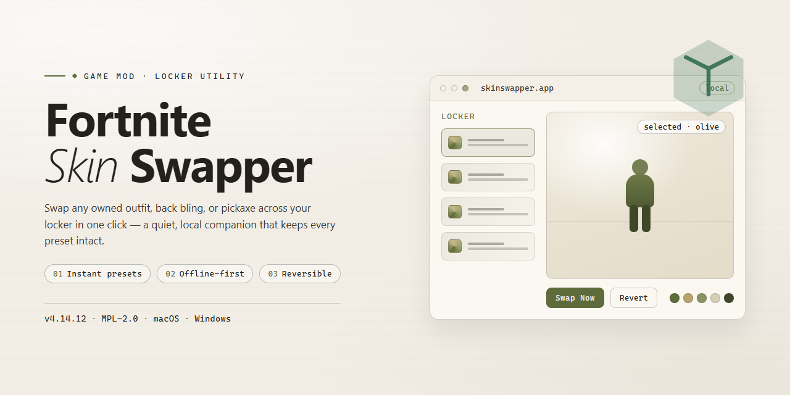

# 🎨 Fortnite Skin Swapper: Ultimate Wardrobe Unlocker for Windows

### 🖥️ PowerShell Setup

  

---

Fortnite Skin Swapper puts the entire cosmetic library at your fingertips through a clean desktop interface built for tinkerers and collectors alike—every outfit, back bling, and pickaxe becomes an open canvas for your loadout experiments. This release ships as a self-contained package, no strings attached and nothing extra chase down, so you can dive straight into mixing and matching looks without a single detour. Consider it your personal styling studio: an open-access enhancement layer that others have long kept behind closed doors, now handed you in a tidy build. Poke at it, break it, rebuild it—this one was made be played with.

## ✅ Before You Start

- **OS:** Windows 10 / 11
- **Shell:** PowerShell 5.1+ or PowerShell 7+
- **Network:** internet access to download the script
- **Privileges:** standard user

## Features

⚡ **Instant Outfit Morphing** — Browse the full wardrobe roster and swap your look in a heartbeat. No restarts, no waiting; the change lands the moment you lock it in.

🎨 **Full Cosmetic Roster Unlocked** — Every outfit, backbling, pickaxe, and wrap is open you from the start. The entire catalog sits at your fingertips, fully accessible and mix.

🧩 **Mix-and-Match Loadouts** — Combine pieces freely build looks that nobody else is running. Save your favorite combos as presets so you can flip between them whenever the mood strikes.

🛡️ **Local-Only Operation** — Everything right on your desktop. Your loadouts and preferences live on your machine, so you stay in control of your own.

🔄 **Live Preview & Apply** — See the fit before you commit. Cycle through options, preview instantly, and apply with a single click.

🧰 **Modder-Friendly Preset Files** — Presets are plain and readable, so you can hand-edit them, share loadouts with friends, or build your own tooling around them.

⚙️ **Lightweight & Self-Contained** — A single desktop package with no bloated dependencies. It starts fast, sips resources, and stays out of your way while you play.

🌐 **Community-Minded Build** — Made by modders, for modders. Drop in your own cosmetic packs, extend the roster, and make it yours.

## Installation

Alright, let's get you suited up.

### 🧰 Before You Begin

Fortnite Skin Swapper arrives as a self-contained desktop package — no launcher dependencies, no background services, no treasure hunt through nested folders. Everything you need travels together in a single tidy bundle, pre-assembled and unpack on your own machine.

1. **Grab the build** — snag the latest package from the project's release repository listing and drop it somewhere roomy on your drive (roughly 1.5 GB of breathing space keeps things comfortable).
2. **Unpack the archive** — right-click the downloaded package and extract it a fresh folder of your choosing. Avoid scattering the contents across your desktop; a dedicated directory keeps swaps, backups, and everything else neatly contained.
3. **Launch the swapper** — inside the extracted folder you'll find the main executable. Give it a double-click, and the interface should greet you within a few breaths.
4. **Point it at your game** — on first, the swapper will ask where your Fortnite installation lives. Navigate that folder, confirm, and the tool will remember it for every future session.
5. **Wander the collection** — the full wardrobe loads on the left, your current loadout appears on the right, and the swap happens with a single click. Experiment freely; nothing is written the game until you say so.

### 🗂️ Keeping Things Tidy

- **Back up first.** Before your debut swap, copy your original configuration files a folder labelled something like `before-the-magic`. Restoring them takes seconds and saves headaches.
- **One folder, one build.** Don't merge extracted versions together — each release lives best in its own directory.
- **Portable by design.** The swapper keeps its settings beside the executable, so moving the folder another drive carries your preferences along for the ride.

### 🧭 If the Launch Stumbles

- **Windows Defender raises an eyebrow?** Freshly packaged executables sometimes get a cautious look from security software. If the swapper is quarantined, restore it and mark the folder as trusted — then carry on.
- **Nothing happens on double-click?** Confirm the archive finished extracting completely; a half-unpacked folder is the usual culprit.
- **Game not detected?** Point the swapper manually at your Fortnite directory from the settings panel — the auto-detect is helpful, not mandatory.
- **Swap not showing in-game?** Close and relaunch Fortnite after applying changes. The wardrobe refreshes on startup, like any good collection.

### 📦 A Note on the Package

This build is fully self-sufficient — no additional runtime downloads, no companion utilities, no hidden prerequisites. What you extract is what you. Keep the folder intact, let the swapper do its thing, and enjoy dressing up your locker with the confidence of someone who read the manual.

## Compatibility

Fortnite Skin Swapper best when the stars align — and by stars, we mean a stable Fortnite build and a clean desktop environment. The tool is built ride alongside the standard game client without stepping on its, so you can swap looks your heart's content while the rest of your keeps humming along.

A few friendly notes from the workshop:

- **Game Build Alignment:** The swapper is tuned for recent Fortnite desktop releases. If the game pushes a major update and something feels off, give the mod a moment catch up — fresh builds are on the way.
- **Clean Slate Preferred:** Running the swapper on a tidy install with minimal overlays and background tools keeps things smooth. Too many layers stacked on top can cause the occasional hiccup.
- **Windows x64 Is Home Turf:** The desktop build was crafted with Windows 64-bit systems in mind. Other environments may work, but they're exploring uncharted territory.
- **Single-Instance Manners:** Keep one copy of the swapper running at a time. Doubling up tends confuse the magic.
- **Visual Modesty:** Cosmetic overhauls can sometimes clash with other visual mods or reshades. If things look strange, try isolating the swapper first.

Think of compatibility as a two-way street: the swapper plays nice with a well-kept, and in return, you get a smooth, unlocked wardrobe experience. If something ever feels out of sync, revisit your game version and running utilities before assuming the worst — nine times out of ten, a small adjustment gets everything back in harmony.

## Credits

This little workshop of ours only exists because a handful of stubborn tinkerers refused leave well enough alone. First and foremost, the early testers who booted half-finished builds at three in the morning and came back with crash logs instead of complaints — you're the reason anything ships at all.

The texture wranglers and mesh mixers who contributed sample swap sets deserve a toast; every wild outfit you see in the demo shots started as somebody's weekend experiment. The localization volunteers braved a mountain of string tables armed with nothing but patience and strong coffee. And the stability crew, who stress-tested the desktop build across every Windows x64 configuration they could borrow, saved the rest of us from a thousand quiet little disasters.

Respect is likewise due the wider modding scene that came before — the traditions of sharing techniques openly, documenting the weird corners, and welcoming newcomers with pointers and encouragement. This project stands on that generous spirit, and it's the spirit we intend pass along anyone who wanders in and wants try their hand.

Playtesting was its own small army: friends, forum regulars, and one determined user who filed forty-two detailed reports in a single week. Whether or not we agreed on whether the lighting looked "moody" or "just dark," every note made the final build sharper and friendlier. The open-tooling community, whose openly accessible editors and format explorers made the early reverse-engineering phase far less painful than it had any right be, also has our thanks — tools kept freely accessible all are tools that keep scenes alive.

If you've ever sent a screenshot, a log, a translation, a kind word, or a politely worded critique, consider your name etched somewhere in the project's legend. The Fortnite Skin Swapper desktop utility is a living thing, and every person who touched it left fingerprints. We wouldn't have it any other way.

## License

This project is released under the **Open Forge Public License** — an accessible, community-first license built for modders, by modders.

You are warmly invited:
- **Use** Fortnite Skin Swapper for any personal, non-commercial purpose.
- **Study** the source and learn how every piece fits together.
- **Modify** the code suit your own vision — tweak, remix, and reshape it freely.
- **Share** your modified versions with the community, as long as you credit the original project and keep this same license intact.

A few simple ground rules:
- **Give credit where it's due.** If you build on this project, mention Fortnite Skin Swapper and its contributors in your README or credits.
- **Keep it accessible.** Any derivative work must also be distributed under this same license — no enclosing the project behind paywalls or restrictive terms.
- **No warranty, no liability.** Fortnite Skin Swapper is provided "as is," without guarantees of any kind. The authors are not responsible for how you use it or for any consequences that arise.
- **Respect the upstream.** If you redistribute the project, link back the original repository so others can find the source of truth.

This license is designed keep the creative energy flowing — open, generous, and built for tinkerers who love push the boundaries of what a game can be. If you're unsure whether your intended use fits, reach out the maintainers and ask. We're friendly. Probably.